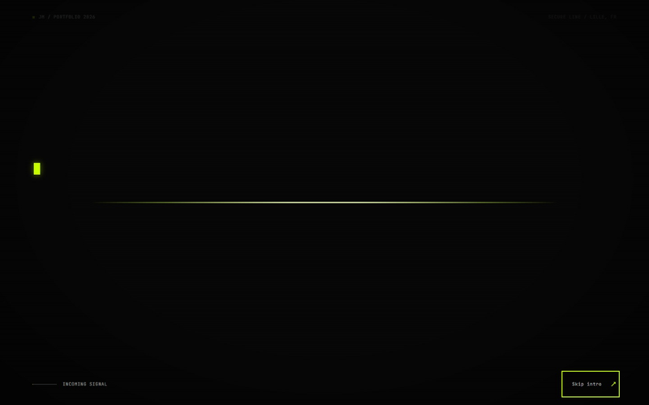

<!-- Header -->
<div align="center">

**Digital Transformation & AI · for sport organisations**

*From the field to the tools.*

[](https://www.julesmoreau.eu)
[](https://www.julesmoreau.eu/fr)
[](https://www.linkedin.com/in/jules-moreau-25405b363)
[](https://maps.google.com/?q=Lille,France)

</div>

---

## 👾 About me

I'm an **M2 International Sport Administration student** at Université de Lille (STAPS), 2025–2027.

I started in club communication, partnerships and events. On every field project I ended up building the tool the team was missing: a Notion handover, a template system, a partner website. Now that's the job I want: **mapping how sport organisations really work, automating what slows them down, and helping teams adopt AI tools.**

My M2 thesis studies **generative AI and no-code tools as levers of professionalisation for sports associations with limited resources**.

> *People first. Then the tool.*

---

## 🛠️ What I build

### 🧠 [Thesis Engine](https://www.julesmoreau.eu/contracts/thesis-engine) · *live, private repo*
Local AI research pipeline behind my M2 thesis. Three scans a day across **Google Scholar, OpenAlex and Cairn** (~90 sources/day), triaged by a **LoRA fine-tuned Qwen3 4B** served 24/7 with Ollama + RAG, escalating complex analyses to **Claude Sonnet**. Everything lands in an Obsidian vault: notes, mind maps, bibliography. Cost ≈ €0/month.

### 🏑 [Royal Daring HC](https://www.julesmoreau.eu/contracts/daring) · *Brussels, 2026*
A sponsor system built to outlive my internship: bilingual FR/NL partner website, brand guidelines, Canva template system, 5-tier sponsorship offer and a **Notion handover** (playbook, editorial charter, 11-format content library).

### 🌐 [Portfolio](https://github.com/julesmoreau62/gotham-portfolio)
Next.js 15 / React 19, FR/EN, Matrix intro, an interactive terminal for the case files, and a machine-readable layer (JSON-LD, hreflang, `llms.txt`).

[](https://www.julesmoreau.eu)

### 🧱 [Client builds](https://www.julesmoreau.eu/contracts/build)
[Ferrant P.H.E](https://ferrantphe.fr) (live, bilingual, PWA) and the first-ever website of a 250-member football club, built with Claude Code and Codex.

---

## 🧰 Stack & Tools


---

## 📡 Where I come from

```
Competition   Volleyball coach · former Overwatch Top 500
The field     Club comms, sponsoring & events: Royal Daring HC, ASN95 (+467% sponsor CTR), ASI (500+ people)
The tools     Notion handovers, template systems, partner websites
AI            Local LLM pipelines, fine-tuning, RAG, team adoption
```

No CS background: I build with AI as an execution layer, and I document so the team can keep going without me.

---

## 🎮 Side quests

- ⚔️ **Overwatch** · former Top 500, currently Grandmaster
- ⚓ French Navy Reserve · Petty Officer
- ⛳ **Golf** · 🏐 **Volleyball** · 📷 Photography (Sony α6400)
- 📚 Gibson · Asimov · Watts · Herbert

---

<div align="center">

*Looking for a **digital transformation & AI internship in a sport organisation** · February → June 2027 · France, Belgium, Europe*

</div>
